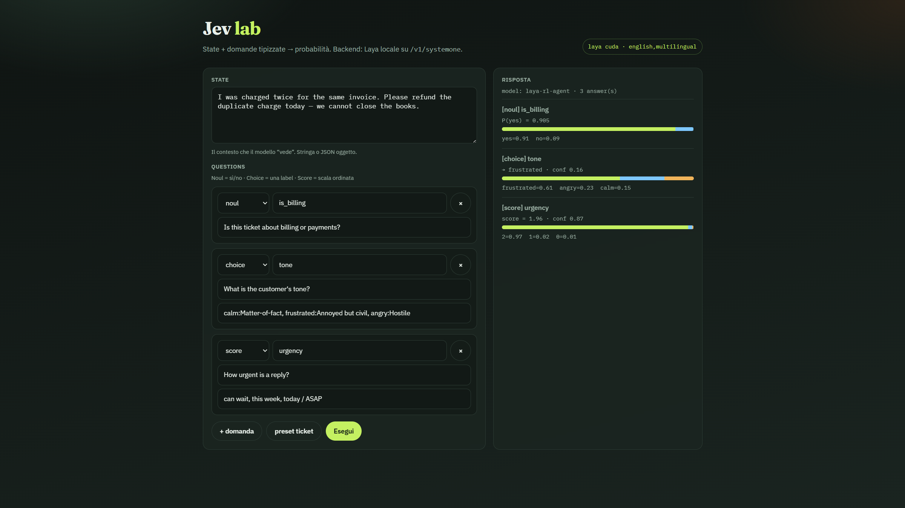

# System One lab — typed decisions (Jev-compatible)

[](https://github.com/OWNER/REPO/actions/workflows/ci.yml)

Hands-on lab for **System One decision models**: give them a `state` and typed questions; get **probabilities**, not generated text.

Same wire shape as TypeSafe’s hosted **Jev** (`POST /v1/systemone`). Local default backend is open-weight **[Laya](https://huggingface.co/convaiinnovations/laya)** (Apache-2.0).

> Independent demo / portfolio project. **Not** affiliated with TypeSafe AI. See [NOTICE](NOTICE).



*Local playground: state + Noul / Choice / Score → calibrated-style probabilities from Laya (`english` / `multilingual`).*

| Primitive | Question | Output |
|-----------|----------|--------|
| `Noul` | Is this true? | `P(yes)` ∈ [0, 1] |
| `Choice` | Which label? | label + distribution |
| `Score` | Where on an ordered scale? | expected score + distribution |

## Why this exists

Shows the pattern used in production for **routing, triage, guardrails, and agent evals**: compare numbers and thresholds instead of parsing LLM prose.

```text
state + questions  →  one forward pass  →  typed probabilities  →  your if p >= θ
```

## Quick start

### 1) Client SDK

```bash
python -m venv .venv
# Windows: .\.venv\Scripts\Activate.ps1
# Linux/macOS: source .venv/bin/activate
pip install -r requirements.txt
cp .env.example .env   # Windows: copy .env.example .env
```

### 2) Local Laya server

First run creates `.venv-laya` and downloads **english + multilingual** checkpoints.

```powershell
# Windows
.\scripts\start_laya.ps1
# CPU only: .\scripts\start_laya.ps1 -Device cpu
```

```bash
# Linux / macOS
chmod +x scripts/start_laya.sh
./scripts/start_laya.sh          # auto: cuda | mps | cpu
./scripts/start_laya.sh cpu      # force CPU
```

→ http://127.0.0.1:8000/health

### 3) Playground UI

```bash
# Windows
.\.venv-laya\Scripts\python.exe scripts\lab_ui.py

# Linux / macOS
.venv-laya/bin/python scripts/lab_ui.py
```

→ http://127.0.0.1:8501

CLI smoke test (server already up):

```bash
python examples/01_tre_primitivi.py
```

## What’s in the repo

```text
examples/          # primitives, ticket routing, agent judge, thresholds
ui/                # playground (proxied to Laya)
scripts/           # start_laya.ps1 / start_laya.sh, lab_ui.py
jev_lab/           # env-based TypeSafe client + pretty printer
tests/             # CI smoke tests (no GPU required)
docs/assets/       # README screenshots
data/              # sample tickets & agent traces
```

## Mental model

```python
from typesafe_sdk import Choice, Noul, Score
from jev_lab import make_client, print_decision

with make_client() as client:
    r = client.system_one(
        state={"ticket": "Charged twice — refund today."},
        questions={
            "billing": Noul(instructions="Is this about billing?"),
            "tone": Choice(
                instructions="Customer tone?",
                criteria={"calm": None, "frustrated": None, "angry": None},
            ),
            "urgency": Score(
                instructions="How urgent?",
                criteria=["can wait", "this week", "today / ASAP"],
            ),
        },
    )

print_decision(r)
if r.nouls["billing"].noul >= 0.8:
    route_to_billing()
```

Point the same code at hosted Jev or local Laya by changing `.env` only.

## Backends

| Backend | Weights | Notes |
|---------|---------|--------|
| **Laya** (`english` + `multilingual`) | Open | Default here; router picks checkpoint from language |
| **Hosted Jev** | Closed | Calibrated API — set `TYPESAFE_API_KEY`, drop `TYPESAFE_BASE_URL` |
| Open-Jev / vllm-jev / Codiv | Open / hosted open | Same `/v1/systemone` shape; see `.env.example` |

Hardware tip: Laya fits a laptop GPU (e.g. 4 GB) or CPU. Large “SOTA open” stacks (≈26B) need much more VRAM.

## CI

GitHub Actions runs `tests/test_smoke.py` on Python 3.10 / 3.12 (imports, layout, primitives — **no** model download).

```bash
pip install -r requirements.txt
PYTHONPATH=. TYPESAFE_API_KEY=local pytest -q tests/test_smoke.py
```

## License

- **This repository:** [MIT](LICENSE) — original lab code and UI.
- **Runtime models / SDKs:** their own licenses (Laya Apache-2.0, etc.). Weights are **not** vendored; they download when you run the server.

## Disclaimer

Jev® / TypeSafe are trademarks of their owners. This lab demonstrates the public System One request shape and open alternatives; it does not redistribute TypeSafe models or claim official status.
